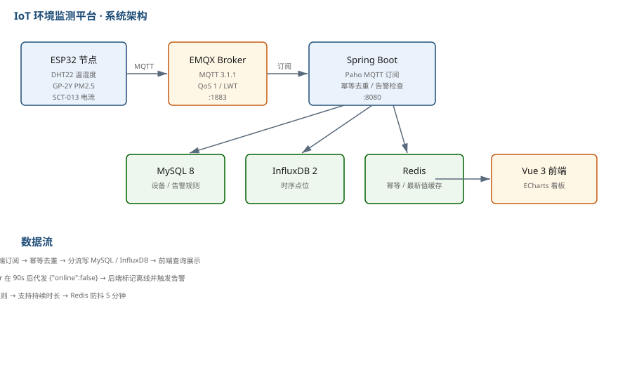

# IoT 工业环境监测与告警平台

基于 ESP32 + MQTT + Spring Boot 的工业环境监测系统，实现温湿度、PM2.5、电流的实时采集、云端存储、可视化展示与阈值告警。



## 背景

工厂车间和机房需要持续监控环境参数，但商用环境监测方案动辄几万元，且数据存在厂商云上无法自主掌控。本项目用 ESP32 + 开源组件搭建一套低成本方案，单节点硬件成本控制在 80 元以内，数据完全自持。

同时作为物联网专业课程设计，目标是完整跑通「感知层 → 网络层 → 平台层 → 应用层」四层链路。

## 技术栈

| 层次 | 技术选型 |
|---|---|
| 感知层 | ESP32-WROOM-32、DHT22（温湿度）、GP-2Y（PM2.5）、SCT-013（电流互感器） |
| 固件 | C++ / Arduino Framework / PlatformIO / FreeRTOS |
| 网络层 | MQTT 3.1.1（EMQX 5.0）、TCP/IP |
| 平台层 | Spring Boot 2.7 / Netty / MySQL 8.0 / InfluxDB 2.7 / Redis |
| 应用层 | Vue 3 / Element Plus / ECharts 5 |

## 架构

```
┌─────────────┐    MQTT     ┌──────────┐   订阅   ┌──────────────┐
│   ESP32     │ ──────────> │  EMQX    │ ──────> │ Spring Boot  │
│  传感器采集  │             │  Broker  │         │  MQTT 接入层  │
└─────────────┘             └──────────┘         └──────┬───────┘
                                                        │
                                    ┌───────────────────┼───────────────────┐
                                    ▼                   ▼                   ▼
                            ┌──────────────┐   ┌──────────────┐   ┌──────────────┐
                            │   MySQL 8    │   │  InfluxDB 2  │   │    Redis     │
                            │ 设备/告警元数据│   │   时序数据    │   │  最新值缓存   │
                            └──────────────┘   └──────────────┘   └──────────────┘
                                    │                   │                   │
                                    └───────────────────┼───────────────────┘
                                                        ▼
                                                ┌──────────────┐
                                                │  Vue 3 前端   │
                                                │  ECharts 看板 │
                                                └──────────────┘
```

## 关键设计

### MQTT 主题设计

采用四级固定层级，便于 ACL 按租户/产品维度做权限控制：

| 主题 | 方向 | 说明 |
|---|---|---|
| `iot/{productKey}/{deviceId}/up` | 设备 → 平台 | 上行遥测数据，JSON 格式 |
| `iot/{productKey}/{deviceId}/down` | 平台 → 设备 | 下行指令（配置下发、重启等） |
| `iot/{productKey}/{deviceId}/status` | 设备 → 平台 | 遗嘱消息（LWT）主题，设备掉线由 Broker 代发 |

**为什么这样设计：**

- 层级固定为 4 级，`{productKey}` 在第二位，ACL 规则可以写成 `iot/{productKey}/#` 一行控制整个产品线
- 用 `deviceId` 而非 IP 做标识，设备换网络不影响订阅
- 上下行分主题，避免自触发回环（设备订阅自己的 up 主题会导致消息风暴）
- 状态用独立主题而非 payload 字段，因为遗嘱消息是 Broker 代发的，必须单独一个主题

### QoS 选择

- 上行遥测：**QoS 1**（至少一次）。工业场景不能丢数据，重复可通过 msgId 幂等去重
- 下行指令：**QoS 1**，配合客户端 ACK 机制确认执行
- 遗嘱消息：**QoS 1**

不用 QoS 2 的原因：四次握手开销大，且我们的去重逻辑已经能处理重复，QoS 2 带来的额外保证收益有限。

### 数据分流存储

| 数据 | 存储 | 原因 |
|---|---|---|
| 设备元数据、告警记录、用户 | MySQL | 结构化、需要关联查询、数据量小 |
| 传感器时序点位 | InfluxDB | 写入量大（2000 设备 × 每 10s 一条 ≈ 200 条/秒）、按时间范围查询多、需要降采样和保留策略 |

MySQL 存时序数据的痛点：索引膨胀快、按时间范围聚合慢、没有内置的降采样能力。InfluxDB 的 `GROUP BY time()` 和 Retention Policy 正好解决这三个问题。

### 掉线检测

用 MQTT 的 **Keep Alive + 遗嘱消息**双保险：

- 设备连接时声明 Keep Alive = 60s，并注册遗嘱消息到 `status` 主题
- 设备正常下线主动发 `{"online": false}`
- 设备异常掉线，Broker 在 1.5 × KeepAlive（90s）后自动代发遗嘱
- 后端订阅 `status` 主题，收到 `online: false` 立即标记设备离线并触发告警

实测从设备断电到平台感知，延迟约 95 秒（KeepAlive 60s × 1.5 + 处理时间）。

## 目录结构

```
iot-env-monitor/
├── firmware/                  ESP32 固件（PlatformIO 工程）
│   ├── src/
│   │   ├── main.cpp           主循环与任务调度
│   │   ├── sensor.cpp         传感器读取与滤波
│   │   ├── mqtt_client.cpp    MQTT 连接管理与上报
│   │   └── config.h           引脚与参数配置
│   └── platformio.ini
├── server/                    Spring Boot 后端
│   ├── src/main/java/com/example/iot/
│   │   ├── mqtt/              MQTT 接入与消息处理
│   │   ├── controller/        REST 接口
│   │   ├── service/           业务逻辑
│   │   ├── entity/            实体类
│   │   └── mapper/            MyBatis Mapper
│   └── pom.xml
├── web/                       Vue 3 前端
│   └── src/
├── docs/                      架构图与设计文档
└── docker-compose.yml         一键启动 MySQL / InfluxDB / EMQX / Redis
```

## 快速开始

### 1. 启动基础设施

```bash
docker-compose up -d
```

启动后：
- EMQX Dashboard: http://localhost:18083（admin / public）
- InfluxDB: http://localhost:8086（admin / admin123456）
- MySQL: localhost:3306（root / root123456）

### 2. 初始化数据库

```bash
mysql -h127.0.0.1 -uroot -proot123456 < server/src/main/resources/schema.sql
```

### 3. 启动后端

```bash
cd server
mvn clean package -DskipTests
java -jar target/iot-server-1.0.0.jar
```

后端启动在 http://localhost:8080

### 4. 启动前端

```bash
cd web
npm install
npm run dev
```

前端启动在 http://localhost:5173

### 5. 烧录固件

修改 `firmware/src/config.h` 里的 WiFi 和 MQTT 地址，然后：

```bash
cd firmware
pio run -t upload
pio device monitor
```

## 界面说明

Web 看板分三块：

| 区块 | 内容 | 刷新方式 |
|---|---|---|
| 实时曲线 | 温度 / 湿度 / PM2.5 / 电流四路，保留最近 100 个点 | WebSocket 增量 `appendData` |
| 设备列表 | 在线状态、最后上报时间、最新读数 | Redis 缓存的最新值 |
| 告警列表 | 按等级筛选，含触发时间与持续时长 | 轮询 + 规则引擎推送 |

> 仓库未附界面截图，按上面「快速开始」五步即可复现完整界面。

## 压测结果

用 `emqtt_bench` 模拟 2000 台设备并发连接，每台每 10 秒上报一次，持续 10 分钟：

```bash
emqtt_bench pub -h 127.0.0.1 -p 1883 -c 2000 -i 2000 \
  -t 'iot/pk1/device%i/up' -m '{"temp":25.3,"humi":60,"pm25":35}' \
  -q 1 -s 60
```

| 指标 | 结果 |
|---|---|
| 并发连接数 | 2000 |
| 消息吞吐 | ~200 msg/s |
| EMQX 内存占用 | 1.2 GB |
| 后端 CPU（4 核） | 平均 35%，峰值 62% |
| 消息端到端延迟 | P50 = 28ms，P99 = 210ms |
| 丢消息数 | 0（QoS 1） |

测试环境：Windows 11 / WSL2，8 核 16G，单机部署。

## 踩过的坑

1. **ESP32 连 MQTT 频繁掉线**
   最初 KeepAlive 设成 15s，设备网络抖动时频繁触发重连，日志刷屏。改成 60s 并加指数退避重连（1s → 2s → 4s → 8s，上限 30s）后稳定。

2. **DHT22 读数偶发跳变到 0 或 65535**
   DHT22 读取间隔必须 ≥ 2s，最初和其他传感器放在同一个 100ms 任务里导致采样过快。改成单独任务、间隔 2.5s，并加滑动平均滤波（窗口 5）后正常。

3. **InfluxDB 2.x 查询语法和 1.x 完全不同**
   网上教程大多是 1.x 的 InfluxQL，2.x 要改用 Flux 语言。降采样查询从
   `SELECT mean(value) FROM temp GROUP BY time(1h)` 变成 Flux 的 `aggregateWindow(every: 1h, fn: mean)`。

4. **MQTT 消息重复入库**
   QoS 1 会重复投递，压测时发现 InfluxDB 里有点位重复。解决方案：消息体带 `msgId`（设备端用 `millis()` + 随机数生成），入库前用 Redis `SETNX` 做幂等判断，TTL 设 60s。

5. **Netty 内存泄漏警告**
   压测 2 小时后出现 `LEAK: ByteBuf.release() was not called`。原因是自定义的 `MqttDecoder` 里异常分支没有 release。改成 `try-finally` 中统一 release 后解决。

6. **Vue 实时曲线卡顿**
   最初每次 WebSocket 推送都 `setOption` 全量更新，2000 设备时页面卡死。改成只保留最近 100 个点、用 `appendData` 增量更新后流畅。

## 后续计划

- [ ] 设备 OTA 升级（基于 MQTT 下发固件分片）
- [ ] 多租户支持（按 productKey 隔离数据）
- [ ] 告警规则支持组合条件（如「温度 > 30 且持续 5 分钟」）
- [ ] 接入 Grafana 做更灵活的看板

## License

MIT
